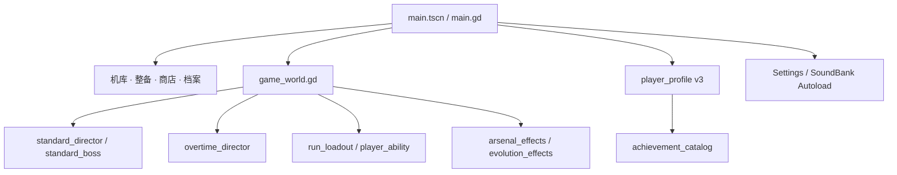

# SCRAPSTORM: NIGHT SHIFT · 架构

当前实现：v0.5.1。这是由创作者确定方向、Codex 主导实现的 Godot 作品集项目；[英文介绍](../README.md)与[中文介绍](README.zh-CN.md)说明可玩内容，[构建报告](BUILD_REPORT.md)保留实际验证范围。下列路径均相对仓库根目录。

## 从入口到一局游戏

`scripts/ui/main.gd` 持有页面状态、接收世界事件，并负责把商店检查点和局末结果交给档案服务。UI 发出购买、选择路线、装备或退出等意图；世界与档案各自校验并执行事务。页面不能直接宣布购买成功或发放成就。

`scripts/game/game_world.gd` 是战斗状态的集成点：推进玩家和敌人、处理伤害与死亡、协调导演与技能、收集统计并导入/导出检查点。它目前较大，是后续重构候选；拆分应保留共享伤害入口与已有行为测试，避免只迁移行数而增加状态分叉。

## 代码地图

| 路径 | 职责 |
| --- | --- |
| `scripts/game/map_catalog.gd` | 三地区、标准阶段和地图配置 |
| `scripts/game/standard_director.gd`、`standard_boss.gd`、`mechanical_encounters.gd` | 敌群、场地危险、首领预警/反制、精英和装置 |
| `scripts/game/overtime_director.gd` | 无尽房型、循环换图、风险/增益及路线随机状态 |
| `scripts/game/run_loadout.gd` | 八工具、改装、槽位、价格、商店交易和六套进化门槛 |
| `scripts/game/player_ability.gd` | 独立技能充能、分支、准星及实际技能效果 |
| `scripts/game/arsenal_effects.gd`、`evolution_effects.gd` | 新工具与进化的持续对象和伤害行为 |
| `scripts/game/combat_feedback.gd` | 有界受击反馈、短停顿和表现事件 |
| `scripts/services/player_profile.gd` | 档案迁移、金币、收藏、历史、记录、检查点与原子写入 |
| `scripts/services/achievement_catalog.gd` | 16 项成就条件、进度和奖励定义 |
| `scripts/ui/archive_panel.gd` | 历史分页/详情、成就预览及已获奖励装备入口 |
| `scripts/ui/shop_panel.gd`、`overtime_panel.gd` | 构筑比较、购买/拆卸和路线选择界面 |
| `scripts/ui/launch_hangar.gd`、`hangar_visual.gd`、`skill_preview.gd` | 机库、实时装备摘要和原创程序绘制预览 |
| `localization/strings.csv` | 英语与简体中文界面文本 |

跨场景 Autoload 仅保留设置和声音服务。玩法的配置与本局可变状态分开；存档以可验证的基本值和集合表示，不序列化场景节点。

## 四种资源与首领循环

| 资源 | 来源和用途 | 生命周期 |
| --- | --- | --- |
| 零件 | 战场回收、房间收入 → 当局购物 | 本局 |
| 喷射储能 | 回收、机制和专用首领补给 → 释放喷射 | 战斗/检查点 |
| 主动技能充能 | 回收、受限普通首领伤害、有限机制事件 → 主动技能 | 战斗/检查点 |
| 金币 | 结算与一次性成就 → 外观、黑洞蓝图 | 本地档案 |

B 方案没有增加第五种货币。首领入场将喷射储能补到至少 100 原始点、技能充满一次；破招补满当前喷射容量并加 30 技能充能，提供六秒输出窗口。机制和电池的回流立即生效，飞行丝带只是限量视觉；不发零件、不治疗。主动技能自身伤害不通过普通伤害路径给自己回充。详见 [B 方案](BOSS_COUNTER_B.md)。

瞄准首领只改变符合条件的自动工具优先级。玩家方向、遮挡、工具射程和发射位置视线继续有效；连锁攻击不重复选择已经命中的目标。

## 保存与结算边界

- **Profile v3** 兼容合法 v1/v2 档案。旧付费 Overdrive 的 180 金币只退一次；既有收藏、标准检查点和记录保留。
- 最近 **100 局**保存详细战斗记录，最近 **256 个 run ID**参与结算去重；终身记录独立累计。此机制防止本机意外重复支付，不是服务器防作弊系统。
- 写操作校验完整候选数据，经临时文件、校验和主备文件更新落盘；失败回滚内存，避免金币已扣而存档未更新。
- 商店检查点保存当前 RNG 状态、货架、已售商品、刷新/拆卸次数、技能分支、风险和增益。恢复不会重新抽货或重复叠加路线收益。
- 档案版本和各模块检查点版本不同。世界检查点外层仍为 v1，Loadout 与 Ability 有自己的兼容读取逻辑。
- 受伤总量、受伤事件与首领受伤单独记录。旧检查点缺少可靠指标时禁止授予无伤成就；结算满血不代表整局无伤。
- 商店不推进战斗时间，不记录停留时长，也不产生停留回充。没有任意战斗帧自动续玩、云同步或历史导出按钮。

无尽复用标准世界的地图和首领，因此两个模式标记可能同时为真；结算优先判断无尽，防止把无尽首领当成完整标准通关。首领计入房间，每完成三房构成一次循环；商店撤离只在首领后开放。

## 表现与性能取舍

普通机体由保留的几何绘制代码烘焙成图集，减少高密度重复绘制；首领、精英、血条、预警和交互装置仍实时绘制。图集生成器和几何回退保留，便于重建与排查。

弹体、地雷、光束、爆破、反馈环与补给丝带有对象上限；表现随机数与玩法随机数分开。短暂停顿上限为 55 毫秒，降低特效选项保留功能性预警。对象有界并不证明所有设备都流畅：v0.5.1 没有新的完整场景帧率基准，也不承诺稳定 60 FPS。

22 个合成 WAV 和三首各三同步层的 Ogg 音乐由项目工具生成。音效池八声部，危险提示有优先级；音乐通过同步层与双组交叉淡化换段。测得无削波不等于已经完成主观听感验收。

## 验证方法与可继续改善的地方

`tests/` 同时保留纯逻辑回归、主场景集成、状态夹具截图和普通输入探针。每种证据注明自身边界；通过脚本不会自动成为真人试玩、浏览器全流程或性能结论。`tools/run_tests.py` 使用隔离档案，检查退出码、错误文本和泄漏信号。

当前 25 套本地 Godot 回归 1,390 项通过。最终 Windows 原导出与独立解压程序启动通过；最终 Web 两次在首店之前自然死亡，未走完商店/路线/重载链路。这些结果和失败样本统一记录在[构建报告](BUILD_REPORT.md)。后续优先解决真人无尽节奏、完整浏览器路径、较低配置长局及世界模块拆分；不把本地测试描述为已经运行的托管 CI。
