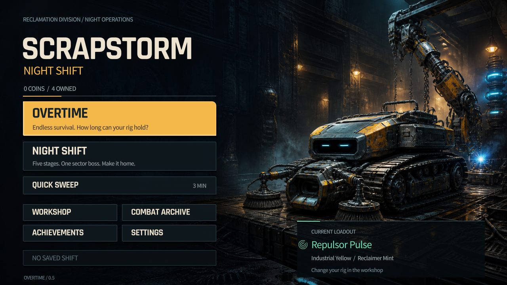
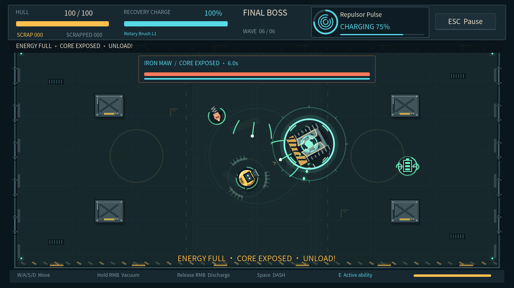
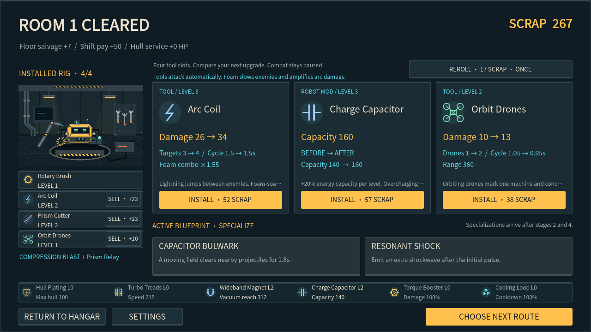
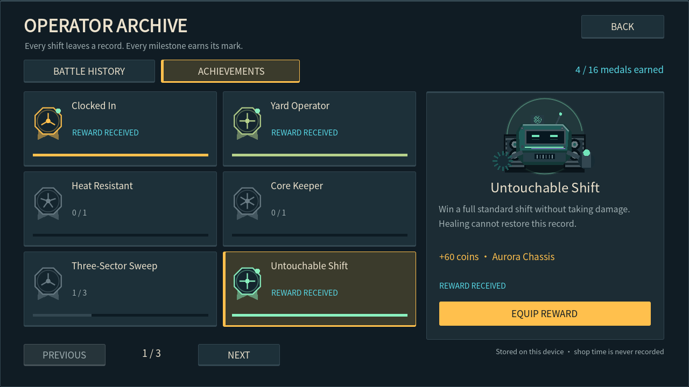

# SCRAPSTORM: NIGHT SHIFT · 午夜清扫队

**Windows 免安装试玩：** 完整解压 Windows ZIP，双击 `Play.cmd` 或 `Scrapstorm.exe`。无需开发工具，朋友首次运行是全新进度，以后保留自己的存档。包内不含作者存档或本地录制模式。见[本次分发检查](DISTRIBUTION_CHECK.md)。

**回收残骸，改造机体，决定什么时候下班。**

免费、单人、2D 俯视角动作生存游戏，使用 **Godot 4.7.2 Standard、typed GDScript 与 Compatibility 渲染器**。驾驶改装清扫机器人穿过夜间工业场地，组合工具进化，并决定继续深入无尽还是带着收益撤离。

[English README](../README.md) · [架构](ARCHITECTURE.md) · [v0.5.1 发布说明](RELEASE_NOTES_v0.5.1.md) · [验证记录](BUILD_REPORT.md)

**[下载 Windows v0.5.1 试玩包 · 约 63 MB](https://github.com/zhangduyou2-cmyk/scrapstorm-night-shift/releases/download/v0.5.1/Scrapstorm-Night-Shift-v0.5.1-Windows.zip)** · **[发布说明与校验文件](https://github.com/zhangduyou2-cmyk/scrapstorm-night-shift/releases/tag/v0.5.1)**

**当前状态：** Windows v0.5.1 已公开发布为免费试玩版，源码及有权授权的原创素材采用 MIT。Web 可在本地构建，暂未提供托管在线试玩。

| 默认机库 | 破招、补能、爆发 |
| --- | --- |
|  |  |
| **四槽构筑** | **成就与外观奖励** |
|  |  |

四张图均由实际游戏渲染并保持原始像素。机库使用全新隔离档案；首领、构筑、成就图使用明确的**展示状态夹具**，不代表真人已打出的进度。[截图来源与复现](media/README.md)。

## 可以玩的内容

| 模式 | 当前玩法 |
| --- | --- |
| **OVERTIME 无尽加班** | 主打模式；四工具槽、每房补给，选择当局增益和下一房风险；每三房首领，每轮换图。首领后可撤离或继续。 |
| **NIGHT SHIFT 标准夜班** | 三个区域任选其一，五阶段共 870 战斗秒后挑战首领，三工具槽。 |
| **QUICK SWEEP 极速清扫** | 三分钟短局，使用已经装备的技能与外观。 |

回收场、铸造厂与反应堆分别拥有自己的场地、敌群变体、首领机制与原创分层配乐。无尽普通房持续 65—80 战斗秒，目标完成可在至少 40 秒后提前结束。商店允许自由思考，**永远不记录商店停留时长**。

八种自动工具包括旋转滚刷、泡沫喷头、电弧线圈、旋转锯片、棱光切割器、追猎导弹舱、轨道无人机和回响地雷，配合六套行为进化和八种临时增益。三种主动技能提供解围、聚怪或工具加速，使用独立充能。首领破招补满喷射能量并提供**六秒爆发窗口**；瞄准首领时，符合射程与视线条件的自动工具优先选择它。

战斗档案保留最近 **100 局**。**16 项成就**奖励金币、原创奖章、涂装、技能色和称号；无伤按真实受伤记录判断，治疗不能抹去受击。外观奖励不增加永久战斗属性。CONTRACTS 挑战合同是后续方向，当前没有空入口。

## 操作与设置

| 输入 | 操作 |
| --- | --- |
| WASD | 移动 |
| 鼠标 | 瞄准及黑洞落点 |
| 按住右键 / 释放 | 回收 / 喷射已储存能量 |
| 空格 | 冲刺 |
| E | 主动技能 |
| Esc | 暂停或返回 |

工具自动攻击。首次启动默认英语，可在 Settings 中切换并保存简体中文；支持改键、按住/切换回收、独立音量和减弱特效。

## 从源码运行

在 **Godot 4.7.2 Standard** 中打开 `project.godot` 并运行主场景。维护中的辅助脚本面向 Windows，需要 PowerShell；验证和打包脚本使用 **Python 3.11+**。

在仓库根目录运行：

```powershell
.\tools\setup_godot.ps1
.\Play.ps1
```

准备脚本下载固定本地引擎；导出模板在构建前另行下载。不需要管理员权限、不修改全局 PATH、不购买工具。打开编辑器可用 `./Play.ps1 -Editor`。

```powershell
.\tools\setup_godot.ps1 -IncludeTemplates
.\tools\build.ps1 -Target All
.\Play.cmd
```

Windows 输出在 `exports/windows-v0.5.1/Scrapstorm.exe`，与相邻 PCK 和许可文件一起保留。Web 输出在 `exports/web`，需要 HTTP 服务，不能直接双击 HTML：

```powershell
python -m http.server 8765 --bind 127.0.0.1 --directory exports/web
```

随后打开 `http://127.0.0.1:8765/`。引擎下载、缓存、导出和原始测试产物不提交到源码仓库；源码检出不等于预编译下载包。[发布准备与分发内容](RELEASE_NOTES_v0.5.1.md)说明了当前状态。

PowerShell 策略阻止脚本时，使用[工具说明](../tools/README.md)的单次进程命令；可选的浏览器/音频依赖也在该文档中。

## 保存与成长

档案只在当前设备保存，Windows 与浏览器不互通，没有账号或云同步。标准与无尽从**最近一次商店检查点**继续，不保存任意战斗帧；工具、商品、随机状态、路线与技能分支均保留。

Profile v3 兼容迁移 v1/v2，保留旧过载购买的一次退款状态。主备校验、事务落盘和结算编号去重防止意外重复领钱。清除浏览器站点存储可能删除其中的进度。当前历史页没有导出按钮。详见[本地数据说明](../PRIVACY.md)。

## 技术与验证边界

本项目展示确定性局内状态、界面与世界分工、统一伤害/交易路径、兼容旧档案、有界战斗效果、双语界面和同步程序音乐。[架构文档](ARCHITECTURE.md)提供代码导航与取舍说明。

- **v0.5.1：** 本地 Godot 25 套、**1,390 项**检查通过；原 Windows 包与独立解压包实际启动并成功退出。
- **首领样本：** 12 场早期构筑隔离交战均击败首领。房间与装备通过夹具建立，交战期使用正常输入；不能说明完整局经济或真人胜率。
- **Web 局限：** 最终包两次尝试都在第一房正常阵亡，每次已经到达的 9 个检查通过，页面/控制台/网络错误为零；但**完整流程没有通过**，未到达本轮商店、路线与续玩恢复。
- **发布入口验证：** 本次另行运行的短浏览器流程 **16 项通过、浏览器与网络错误为零**，覆盖中英文刷新保留、两种窗口尺寸、三模式启动、暂停、主动技能、正常退场与战斗历史重载。没有把短流程写成首领通关或商店续玩验证。启动 Web 服务后，开发者可选运行 `npm ci`、`npm run browser:install`、`npm run smoke:release`；游玩和核心构建不需要 Node。
- 本轮未重新完成全场性能采样，不承诺稳定 60 FPS。深层无尽、较低配置及音乐/战斗主观体验仍需反馈。

运行 `python tools/run_tests.py` 可执行本地回归。[构建报告](BUILD_REPORT.md)保留版本、哈希、失败样本与覆盖范围；本地结果不等于托管 CI 已运行。[路线图](ROADMAP.md) · [更新记录](../CHANGELOG.md) · [贡献指南](../CONTRIBUTING.md)。

## 作者与素材

创作者 **[zhangduyou2-cmyk](https://github.com/zhangduyou2-cmyk)** 负责概念、范围取舍、试玩反馈和最终批准。**OpenAI Codex** 主导实现，并协助设计、原创程序图形/音频、集成、验证与文档。本项目明确展示 AI 辅助开发过程，不声称全部代码手写或音乐由人类作曲。

机库原画由 AI 生成，战斗/UI 几何、动画图集和合成配乐/音效均有对应来源记录。Noto Sans CJK、Rajdhani 和 Godot 保留各自许可与声明。[制作署名](../CREDITS.md) · [素材台账](ASSET_REGISTER.csv) · [第三方声明](../THIRD_PARTY_NOTICES.md) · [安全反馈](../SECURITY.md)。

项目代码、文档及原创素材在创作者有权授权的范围内采用 [MIT 许可](../LICENSE)，第三方组件保留各自条款。[许可范围](LICENSING.md)。本项目未购买付费素材或服务。[GitHub 首发说明](PUBLISHING.md)。
